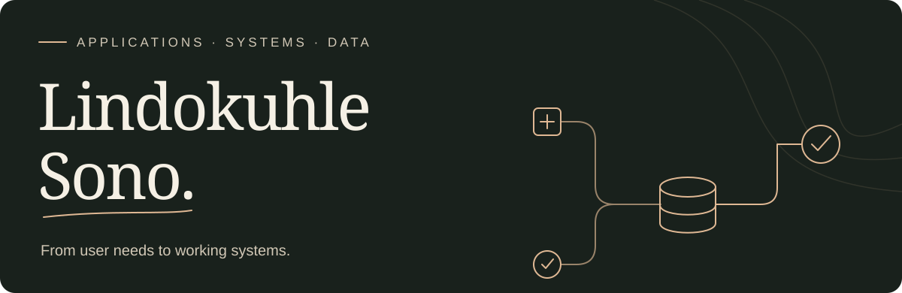

  

  <strong>Applications Developer I · Johannesburg, South Africa</strong> 
  Connecting business processes, application behaviour and the data behind them.

  <a href="https://lindokuhle-sono-portfolio.vercel.app/"><strong>Explore my portfolio ↗</strong></a>
  &nbsp; · &nbsp;
  <a href="https://www.linkedin.com/in/lindokuhle-cicealleen-sono/">LinkedIn</a>
  &nbsp; · &nbsp;
  <a href="https://lindokuhle-sono-portfolio.vercel.app/Lindokuhle_Sono_CV.pdf">CV</a>

---

I'm an **Applications Developer I at Gijima**, working across enterprise applications, SQL Server and operational systems. My experience spans requirements and workflow analysis, application development, testing, release preparation and production support.

I've visited operational sites, worked with clients and end users, and investigated application and data issues affecting their workflows. Those experiences shape how I approach a change: understand the business process it needs to support, consider its impact on connected systems, and help prepare it for testing and release.

**Understand the process** 
I translate user needs and operational workflows into requirements, business rules and functional documentation.

**Build and investigate** 
C# and VB.NET application changes, integrations and SQL Server investigations. I work with procedures, views, triggers and data validation, including schema comparison before testing and release.

**Test and improve** 
Test matrices, functional and regression testing, QA/UAT support and reproducible defect reports. I've also developed a Python- and JavaScript-based GUI testing tool with AI assistance, capturing pass/fail results, failure screenshots and execution logs.

### My working toolkit

| Area | Technologies and practices |
| :--- | :--- |
| Applications | C# · VB.NET · Windows Forms · JavaScript · HTML · CSS |
| Data | SQL Server · T-SQL · SSDT · Schema Compare · Data modelling |
| Quality | Python · GUI test automation · Regression testing · QA/UAT |
| Delivery | Git · Azure DevOps · Visual Studio · ServiceNow · IIS |
| Analysis | Requirements · Business rules · Workflow mapping · UML |
| Reporting | Power BI · Excel |

<strong>Academic foundations & additional tools</strong>

Laravel / PHP, Bootstrap and MySQL through university application development; Jupyter Notebook through academic data work. My CV also includes Flutter and practical use of AI tools including Claude, OpenAI Codex, OpenRouter and ElevenLabs.

### A little of the person behind the code

I graduated **cum laude with an Advanced Diploma in ICT — Applications Development** from the University of Mpumalanga in 2023, after completing my Diploma in 2022.

As a **SQL Database Tutor**, I learnt how much a different explanation or example can help someone understand a difficult concept. That habit still shapes how I document work and share knowledge.

Beyond work, I enjoy photography, sketching and painting. I also spend time gaming, watching anime and exploring topics that spark my curiosity.

---

  <strong>Understand the workflow. Follow the data. Test the change.</strong>  
  <a href="https://lindokuhle-sono-portfolio.vercel.app/contact">Let's connect ↗</a>

